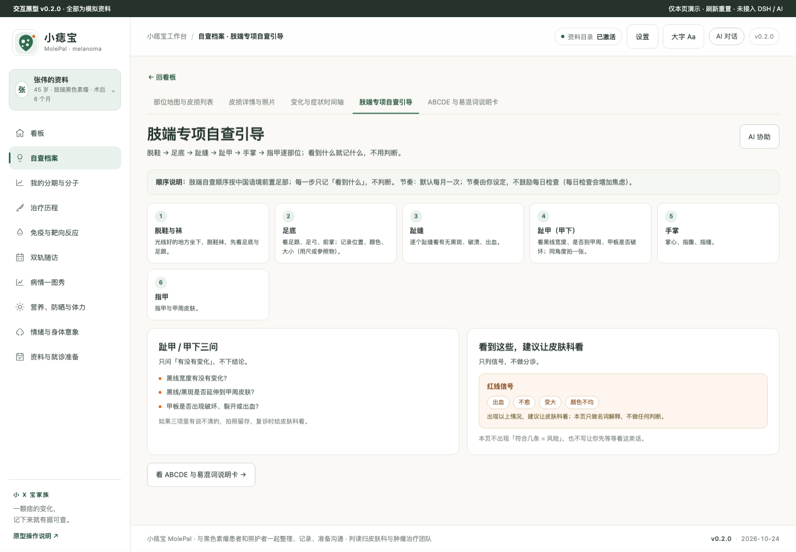
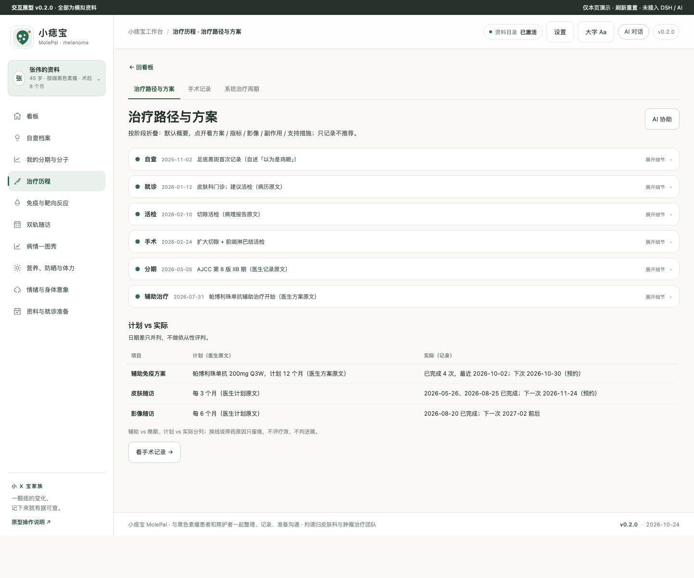
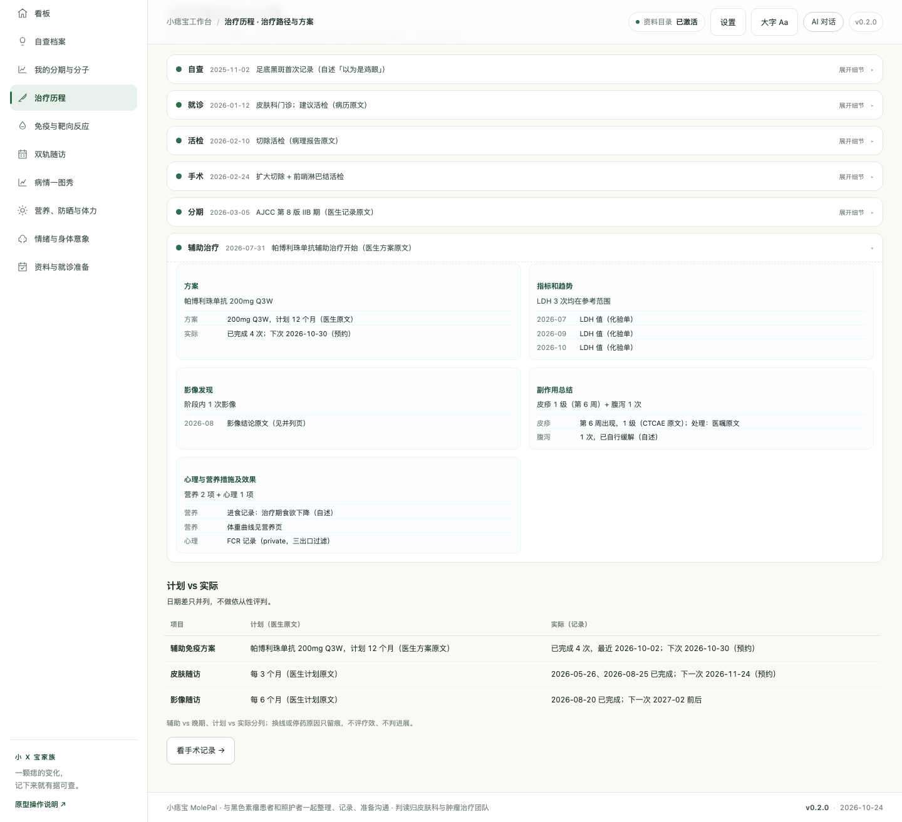
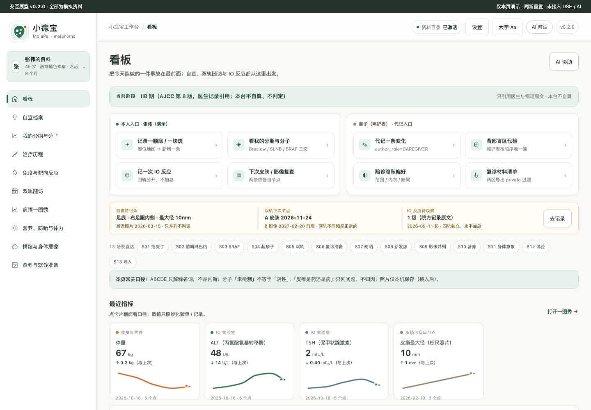
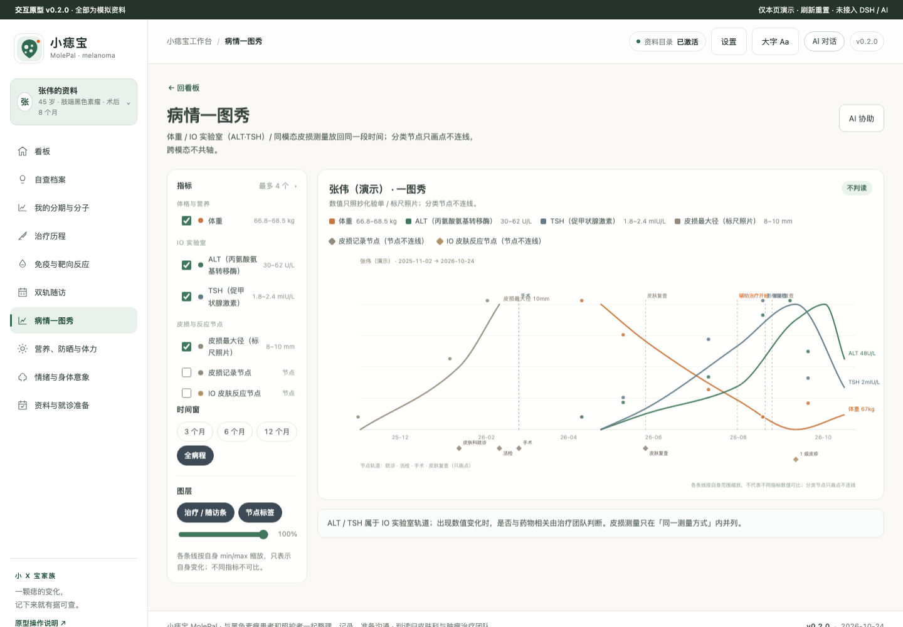

# 小痣宝 MolePal · 皮肤黑色素瘤患者工作台

面向**皮肤黑色素瘤患者与照护者**的本机资料工作台：把自查记录、分期与分子、治疗与副作用、双轨随访整理成**可核对、可回溯、能带去门诊**的资料。
**只做信息整理与就诊准备，不做诊断、不做良恶性判断、不做分期判定、不给治疗方案建议。**

## 疾病概要

> 顶栏「?」打开完整版（含逐段来源与页码）。这一段只做**解释**：这个病是什么、依据哪些文件、指南列过哪些手段、这些年发生了什么变化。它不是对你个人情况的判断，也不构成任何建议。

### 定义

黑色素瘤是起源于黑素细胞的恶性肿瘤，可发生在皮肤、黏膜、眼葡萄膜等部位；本台只整理皮肤型。中国卫健委《黑色素瘤诊疗指南（2022 年版）》记载，亚洲及有色人种原发于肢端的黑色素瘤约占 50%，黏膜型 20%–30%，白种人皮肤型约 90%。分期按 AJCC 第 8 版；分子分型常看 BRAF V600、NRAS、c-KIT、TERT。

自查口诀有两套：中国指南写 ABCDE 的 E 是 Elevation（隆起），NCCN 与美国癌症协会写 E 是 Evolving（演变），甲下还有一套 ABCDEF；两套并存，不能合成一套冒充「国际统一」。直径阈值不是诊断线。肢端与甲下是中文语境里的自查重点（足底、趾缝、甲下、手掌）。**Breslow 厚度与溃疡是 AJCC 第 8 版 T 分期的输入变量**：厚度按毫米记录，溃疡记「有 / 无」，两者一起进 T 分期（T1 按厚度与溃疡分成 T1a / T1b）；它们是分期的原料，不是「严重程度评分」，也不能脱离 N 与 M 单独读成早期或晚期。本台不判断一颗痣是良性还是恶性，判读归皮肤科。

**来源**：国家卫生健康委员会 · 黑色素瘤诊疗指南（2022 年版）· 2022-04 · 原件已取得 · 页码 P2–P3、P5–P6 ｜ NCCN · NCCN Guidelines for Patients: Melanoma 2026 · 基于 V1.2026（2026-02-17）· 原件已取得 · 页码 P6、P14 ｜ AJCC · Cancer Staging Manual · 第 8 版（出版年份未核实）· 未取得原件，据二次来源 · 页码待核

### 医学资料规范和指南情况

一台一表，不合并。未取得原件的只记「存在、大致讲什么」，不引用具体条文；两套分期体系并存时两行都列，本表不做换算。

| 机构 | 文件 | 版本 / 日期 | 原件 | 本台的用途 |
|---|---|---|---|---|
| 国家卫生健康委员会 | 黑色素瘤诊疗指南（2022 年版），24 页 | 2022-04 发布 | 已取得（PDF） | 中国口径的分期、SLNB 适应证、BRAF/CKIT/NRAS 检测、国内上市靶向药清单 |
| NCCN | NCCN Guidelines: Melanoma: Cutaneous | V3.2026（官网页面显示） | 未取得（全文需授权，仅元信息） | 辅助与晚期治疗的分层结构 |
| NCCN | NCCN Guidelines for Patients: Melanoma 2026 | 基于 V1.2026，2026-02-17 | 已取得（PDF） | 患者版表述、SLNB 阈值、随访间隔、irAE 清单 |
| CSCO | CSCO 黑色素瘤诊疗指南 | 2025 版（据学会入口） | 未取得（全文需购买） | 仅记存在，本台未引用其条文与页码 |
| ASCO | Management of irAEs in Patients Treated With Immune Checkpoint Inhibitor Therapy | 2021 版 | 未取得（据二次来源） | irAE 的器官谱与管理原则 |
| AJCC | AJCC Cancer Staging Manual | 第 8 版（出版年份未核实） | 未取得 | 分期字段口径 |

版本要写实际版本：任务书里写的 NCCN 2.2025，在 2026-10 的官网页面已经是 3.2026，本台按 3.2026 记，不沿用旧版页码。中国口径以卫健委 2022 版为基线；该版没有随访章节，药物清单停在 2022 年。CSCO 2025 全文未取得，凡涉及「中国最新推荐」的条目一律停在「待核验」。

**来源**：见上表逐行；CSCO 状态据中国临床肿瘤学会指南订购入口（2025 版，全文需购买，未取得，页码待核）

### 目前治疗全景概要

只列指南与说明书里出现过的手段类别，按病期与线序分组，不排序、不比优劣。分子分型是很多药物的前提条件，不是严重程度。

**早期 · 可切除（0–II 期）**：原发灶切除并送病理，切缘宽度按 Breslow 厚度分档；前哨淋巴结活检（SLNB），中国指南写 Breslow 厚度大于 1 mm 推荐，NCCN 患者版写 T1b 起「可能推荐」、T1a 通常不推荐，两套阈值并存、本台不换算；确诊路径里的完整（切除）活检，NCCN 患者版写浅表刮取在怀疑黑色素瘤时一般不做，中国指南写一般不采取削刮和穿刺。

**III 期 · 术后辅助**：BRAF V600 突变者用达拉菲尼联合曲美替尼（中国说明书含 III 期完全切除后辅助治疗）；PD-1 抑制剂辅助被 NCCN 列出，但本台所见中国说明书版本未收录辅助适应症，中国可及性需另核。辅助治疗与晚期治疗是两件事，本台把治疗意图作为单独字段记录。

**晚期 · 不可切除或转移**：BRAF+MEK 靶向（达拉菲尼+曲美替尼、维莫非尼，限 BRAF V600 阳性；康奈非尼+比美替尼在中国医药信息查询平台站内检索无结果，标待核验）；PD-1 抑制剂（帕博利珠单抗所见说明书为经一线治疗失败，特瑞普利单抗为既往全身系统治疗失败）；CTLA-4 抑制剂（伊匹木单抗单药 3 mg/kg 每 3 周×4 次，与纳武利尤单抗联合的中国适应症未在所见说明书中体现）；KIT 抑制剂（伊马替尼、尼洛替尼，卫健委 2022 版列为国内上市药物）。

**需要单列的情形**：黏膜型、葡萄膜型、儿童黑色素瘤各有自己的分期与治疗路径，本台不把皮肤型的模板套过去。药物卡片分三层记录：中国说明书适应症 / 中国指南提及 / 国际指南推荐，三层不合并成一句「适合你」。

> 以上是文献与指南里列出的手段，按病期与线序排列，不代表任何一项适合你。选哪一个，这一句需要问你的医生。

**来源**：国家卫生健康委员会 · 黑色素瘤诊疗指南（2022 年版）· 2022-04 · 原件已取得 · 页码 P5–P6、P12–P15 ｜ NCCN · NCCN Guidelines for Patients: Melanoma 2026 · 基于 V1.2026 · 原件已取得 · 页码 P20–P21、P42–P57 ｜ 中国医药信息查询平台 · 七份药品说明书 · 访问 2026-10-24 · 未取得原件，据二次来源 · 页码待核（批准日期与批件号未核实）

### 发展趋势

只写已经发生的事实，每条带日期或版本号。

- **指南版本**：项目 2026-10-24 记录，任务书指定的 NCCN V2.2025 已被 V3.2026 取代（官网页面显示 V3.2026）；患者版 2026-02-17 发布，基于 V1.2026，与临床版 V3.2026 不是同一版本号。
- **监管批件（说明书级）**：曲美替尼联合达拉菲尼的「III 期完全切除后辅助治疗」已见于中国说明书，批准日期与批件号未核实（NMPA 官网返回 412）；纳武利尤单抗所见中国说明书未含黑色素瘤适应症。
- **在研登记**：2026-10-25 快照，去重后 294 条（CTV 186 条、中国药物临床试验登记与信息公示平台 108 条），登记状态未核实；阶段分布在本次采集中未取得。
- **分类体系**：本台按 AJCC 第 8 版整理分期；项目资料未见更新的分期版本记载，是否有新版未核实。
- **指南结构**：卫健委 2022 版没有随访章节；CSCO 2025 全文未取得，因此本台随访间隔数字来自 NCCN 患者版与 AIM，不是中国指南原文。

**来源**：NCCN · Guidelines: Melanoma: Cutaneous / for Patients · V3.2026 / 2026-02-17 · 临床版未取得原件（仅元信息）、患者版原件已取得 ｜ 中国医药信息查询平台 · 曲美替尼片、纳武利尤单抗说明书 · 访问 2026-10-24 · 未取得原件，据二次来源 · 批准日期与批件号未核实 ｜ 本项目登记快照 · research/melanoma-cancer/manifest.json · 2026-10-25 · 原件已取得（阶段字段未采集） ｜ 国家卫生健康委员会 · 黑色素瘤诊疗指南（2022 年版）· 2022-04 · 原件已取得 · 目录（无随访章节）

## 关键功能

### 自查档案：从"这颗痣好像变了"开始（确诊前形态）

按部位与时间记录你看到的变化，照片只存本机。肢端引导按中国语境排顺序（足底→趾缝→甲下→手掌），并把"鸡眼/灰指甲/甲下血肿"这些常被混淆的说法讲清楚——**解释不是诊断**。

### 治疗路径：默认概要，点开看细节

每个病情阶段一张折叠卡：默认只显示「阶段 · 日期 · 一句话概要」，一眼看到走到哪一步。

点开任意阶段，同一处看到**方案 / 指标和趋势 / 影像发现 / 副作用总结 / 心理与营养措施及效果**——适合复诊时医生按需了解细节；打印时全部自动展开。

### 看板：今天该做什么

患者本人与照护者各有"现在可以做"的入口（配偶可代检背部盲区并代记）。

### 病情一图秀：变化发生在哪一步

多指标与治疗/检查节点同轴；分类序列只画节点不连线。

## 怎么用（DSH Desktop）
1. 工作台列表添加「小痣宝」（本地 tgz：`release/xyb-community-melanoma-workbench-0.3.1.tgz`，或 profile `pnpm add`）；
2. **首次使用先在左侧会话列表新建一个会话**（宿主按会话授权本台接口，否则显示离线演示数据）；
3. 数据保存在你选择的**本机资料目录**，不联网同步。

## 数据与口径
- 演示数据为合成；试验线索为真实登记库样例，**登记状态，未核实**（登记 ≠ 有效 ≠ 可入组）。
- 分子三态：**未检测 ≠ 阴性**；影像与副作用只照抄原文，不判读、不归因。
- FCR（复发恐惧）与身体意象默认私密，导出/AI/摘要三处出口按 visibility 过滤。

## 开发
- 闸口与里程碑：`docs/DEV-PLAN.md`（G1/G2/G3 + V1/V2/V3）；调研与设计：`docs/{USER-RESEARCH,SCENARIOS,DIFF-MATRIX,SPEC}.md`
- 检查：`npm run check`（27 项单测 + 红线词表 + 冻结 sha256 + 版本同源）；走查：`npm run probe`（64 页签/HVT/窄宽）
- 截图规范：README 截图按 starter `docs/33-README-SCREENSHOTS.md`（本页 5 张为 0.3.1 实渲），治疗路径折叠卡模版见 starter `docs/32-TREATMENT-PATHWAY-FOLDOUT.md`
